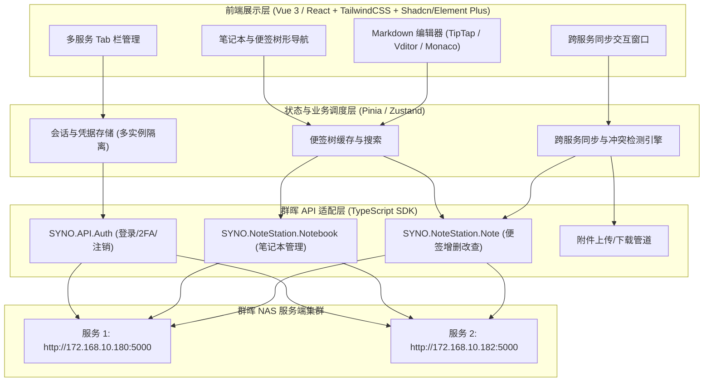

# 群晖 Note Station 增强客户端可行性分析与开发方案

## 一、 项目背景与需求拆解

基于 `docs/开发文档.md`，现有官方 Note Station 客户端（基于老旧的 NW.js / Chrome App 架构）无法满足深度笔记用户的高效生产力诉求。本项目旨在基于群晖官方 Web API 重新实现一款跨平台、现代化界面的增强型 Note Station 桌面客户端（Note Station Plus）。

### 核心功能需求拆解
1. **Markdown 格式深度支持**：支持语法高亮、实时预览/所见即所得、数学公式（KaTeX）、代码高亮、表格、任务列表以及图片粘贴自动上传；
2. **多服务多账号并行登录与 Tab 切换**：支持同时配置并登录多个 NAS 实例（如公司 NAS、家庭 NAS），通过顶部 Tab 便捷切换上下文；
3. **跨服务便签单向/双向同步**：指定便签快速同步至其他已登录服务，具备“标题匹配自动覆盖更新”或“目标服务自动新建”能力；
4. **跨平台兼容交付**：原生支持 Windows 10、Windows 11 以及 Ubuntu Desktop 24.04 LTS；
5. **群晖官方 Web API 适配**：不破坏群晖既有存储结构，兼容 DSM 6.x 与 DSM 7.x 的 Note Station 服务。

---

## 二、 关键技术可行性深度分析

### 2.1 群晖官方 Web API 接口可行性：**完全可行**
群晖 DSM 提供了成熟的 Web API 体系（基于 `/webapi/entry.cgi` 与 `/webapi/auth.cgi`）：
* **认证机制 (`SYNO.API.Auth`)**：
  * 支持用户名/密码登录，返回认证令牌 `_sid`，后续请求通过 Cookie 或 URL Query 携带 `_sid` 即可；
  * 支持两步验证（OTP/2FA）；
  * 提供 `logout` 机制，会话管理清晰。
* **API 发现机制 (`SYNO.API.Info`)**：
  * 可动态探测当前 NAS 支持的 `SYNO.NoteStation.*` 模块路径及最大/最小版本号，具备良好的向前/向后兼容性。
* **笔记与笔记本服务 (`SYNO.NoteStation.*`)**：
  * `SYNO.NoteStation.Notebook`：支持笔记本/笔记本组的 `list`、`create`、`set`、`delete`；
  * `SYNO.NoteStation.Note`：支持笔记条目的 `list`（列表检索）、`get`（获取 HTML 内容与元数据）、`create`（新建笔记）、`set`（更新笔记）、`delete`（删除至废纸篓）；
  * `SYNO.NoteStation.Tag`：支持标签的列表与挂载；
  * `SYNO.NoteStation.Attachment`：支持图片和附件的上传、下载与预览。

> **结论**：所有交互均在群晖官方 Web API 支持范围内，无需篡改服务端数据库或安装任何非官方套件。

---

### 2.2 Markdown 编辑与数据双向兼容可行性：**完全可行**
* **存储格式特征**：群晖 Note Station 服务端底层采用 SQLite 存储富文本 HTML（`<p>...</p>`, `` 等）。
* **技术解决路径**：
  1. **Markdown 转 HTML（保存时）**：使用高性能解析引擎（如 `markdown-it` / `marked`），将用户编辑的 Markdown 编译为标准 HTML 提交给 Note Station API；
  2. **HTML 转 Markdown（打开历史便签时）**：使用 `turndown`（结合 GFM 插件），将服务端既有的 HTML 笔记无损反解为 Markdown 语法；
  3. **无损源文本保留策略（核心创新点）**：
     * 为避免“Markdown -> HTML -> Markdown”多次往返转换产生的微小排版衰减，客户端在保存笔记时，可将原始 Markdown 文本以隐式注释形式（如 `<!-- note-station-plus:md <base64> -->`）嵌入 HTML 尾部；
     * Note Station 官方客户端或 Web 界面解析 HTML 时会自动忽略该注释，完全正常显示；
     * 本客户端读取时优先提取该注释中的原生 Markdown 字符串，实现 100% 无损还原。

---

### 2.3 多服务多会话管理与 Tab 切换可行性：**完全可行**
* **独立会话隔离**：
  * 采用客户端独立网络客户端实例池（`Map<serverId, AxiosInstance>` 或 `Fetch` 客户端）；
  * 每个实例各自持有独立的 `baseURL`、`_sid`、Cookie Jar 以及网络超时/重试策略，物理隔离不同 NAS 之间的状态；
* **Tab 状态调度**：
  * 渲染进程采用现代响应式状态管理（如 Pinia 或 Zustand），以 `activeServerId` 作为根路由/视图切换凭证；
  * 切换 Tab 时无需重新请求登录，直接读取本地持久化会话与内存缓存树，实现毫秒级即时切换。

---

### 2.4 跨服务便签同步与冲突处理可行性：**完全可行**
* **标题匹配与 Upsert 逻辑**：
  1. 从源服务获取当前便签完整数据（Title, Markdown Content, Tags, 附件列表）；
  2. 调用目标服务的 `SYNO.NoteStation.Note` `list` 接口，在目标笔记本（或全库）中检索是否存在同名 `title` 的笔记；
  3. **若匹配到已有笔记**：
     * 弹出确认或依据用户策略（覆盖/跳过/创建副本）；
     * 若覆盖，调用目标服务的 `set` 接口更新目标 `object_id` 的内容；
  4. **若未匹配到**：
     * 调用目标服务的 `create` 接口，在目标笔记本中新建便签。
* **图片与多媒体附件迁移**：
  * 提取便签中的图片及附件，先从源服务以二进制流下载，随后调用目标服务的附件上传接口，并将新生成的附件链接替换到目标笔记正文中，保证同步后的笔记附件不丢链、不依赖源服务公网访问。

---

### 2.5 跨平台运行环境适配可行性：**完全可行**
* **目标操作系统**：Windows 10、Windows 11、Ubuntu Desktop 24.04 LTS。
* **框架推荐**：**Electron (v32+) + Vite + Vue 3 / React + TypeScript**。
  * **Windows**：构建输出标准 NSIS 安装包（`.exe`）与绿色免安装版（Portable）；
  * **Ubuntu Desktop 24**：Ubuntu 24.04 原生支持 Wayland 与 X11，Electron 30+ 能够完美适配 Ubuntu 24.04 依赖库，支持打包为 `.deb` 和 `.AppImage`。

---

### 2.6 潜在风险与应对措施

| 风险项 | 影响评估 | 应对策略 |
| :--- | :--- | :--- |
| **自签名 SSL 证书阻断** | 很多内网 NAS 采用自签名证书，默认 HTTPS 请求会报证书错误 | 客户端提供“允许自签名证书”配置项（Node/Electron 底层设置 `rejectUnauthorized: false`） |
| **网络隔离或休眠唤醒断线** | 局域网断网或电脑休眠导致 `_sid` 失效 | 实现静默重新登录拦截器（HTTP 401/403 或群晖错误码自动触发 re-login 并重试） |
| **同名便签多重冲突** | 目标服务存在多个同名便签时可能误覆盖 | 匹配时提供列表选择器，或采用“优先匹配指定同名笔记本中的笔记” |
| **大附件同步耗时** | 笔记含有数十兆文件时阻塞 UI | 异步后台任务队列设计，提供进度条与结果通知 |

---

## 三、 系统架构与技术选型方案



### 3.1 核心技术选型

| 模块 | 推荐选型 | 选型理由 |
| :--- | :--- | :--- |
| **宿主框架** | **Electron (v32+) + Vite** | 成熟生态，完美跨平台构建 Win10/11 与 Ubuntu 24，本地文件与安全存储能力完备 |
| **前端框架** | **Vue 3 (Composition API) + TypeScript** 或 **React + TS** | 响应式开发效率高，类型安全，易于维护复杂的多实例树状数据结构 |
| **样式与组件库**| **TailwindCSS + Naive UI / Shadcn** | 现代化沉浸式外观，轻量，支持深色/浅色主题随系统自动切换 |
| **Markdown 引擎**| **Vditor** 或 **TipTap (Markdown Extension)** | Vditor 支持即时渲染（类似 Typora）、分屏预览、源码模式，自带数学公式、图表、大纲解析，开箱即用 |
| **本地安全存储**| **electron-store + safeStorage** | 加密保存 NAS 密码与 session token，避免明文泄露 |
| **打包分发** | **electron-builder** | 一键打包 Windows (`nsis`, `portable`) 和 Linux (`deb`, `AppImage`) |

---

## 四、 核心功能模块设计

### 4.1 多服务 Tabs 与会话管理
* **服务配置模型**：
  ```typescript
  interface SynologyServerConfig {
    id: string;               // 唯一标识 (UUID)
    name: string;             // 显示名称 (如 "办公室 NAS", "家庭 NAS")
    baseURL: string;          // 例如 http://172.168.10.180:5000
    account: string;          // 账号
    encryptedPassword?: string;// 安全存储密码
    allowInsecureSSL: boolean;// 是否忽略 SSL 校验
    activeSid?: string;       // 当前有效 Session ID
    status: 'connected' | 'connecting' | 'disconnected' | 'error';
  }
  ```
* **Tab 交互模式**：
  * 顶部支持类似 Chrome / VS Code 的 Tab 栏，用户可自由添加、编辑、断开、排序各 NAS 节点；
  * 每个 Tab 保存当前打开的笔记 ID 与滚动位置，切换 Tab 立即恢复上下文。

### 4.2 Markdown 增强编辑体验
* **编辑模式**：所见即所得模式（WYSIWYG）与 Markdown 源码/双栏模式自由切换；
* **剪贴板扩展**：复制本地或网页图片直接粘贴进编辑器，自动后台上传至当前 NAS 的 Note Station 附件库，并自动插入 Markdown 图片语法 ``；
* **格式增强**：数学公式（LaTeX/KaTeX）、流程图（Mermaid）、代码块行号与语法高亮、Checklist 待办清单。

### 4.3 跨服务便签同步工作流（Sync Engine）
1. **触发同步**：在便签列表右键或编辑器工具栏点击「同步到其他服务」；
2. **选择目标**：弹窗选择已连接的目标 NAS 实例与目标笔记本（默认同名笔记本或“默认笔记本”）；
3. **查重匹配**：
   * 同步引擎在目标 NAS 中查询是否有相同 `title` 的笔记；
   * **若命中**：对比修改时间戳，提示用户选择「覆盖目标内容」、「保留两者（生成副本）」或「取消」；
   * **未命中**：直接调用目标 NAS `create` 接口创建新便签；
4. **媒体重构**：如包含图片附件，自动将源端图片流转存至目标端并替换 URL；
5. **结果反馈**：同步完成后提示 Toast，并在目标 Tab 的对应笔记列表触发更新。

---

## 五、 开发实施计划与里程碑

本项目划分为 **5 个迭代周期**，预计总工期 **3 ~ 4 周**，具体计划如下：


### 阶段 1：技术验证与群晖 API SDK 封装 (3~4 天)
* [ ] 搭建统一网络请求层，处理 DSM 登录、登出、`_sid` 维护与超时重试；
* [ ] 封装 `SYNO.NoteStation.Notebook`（笔记本列表、创建、删除）；
* [ ] 封装 `SYNO.NoteStation.Note`（笔记列表分页、按笔记本筛选、内容读取、保存、删除）；
* [ ] 验证附件上传/下载管道；
* [ ] 单元测试验证（支持配置测试 NAS 地址）。

### 阶段 2：桌面应用骨架与多服务 Tabs (4 天)
* [ ] 初始化 Electron + Vite + Vue 3 / React + TypeScript 项目架构；
* [ ] 实现本地安全配置中心（NAS 连接配置、加密密码存储）；
* [ ] 顶部 Tabs 栏：支持新建服务、切换当前活动服务、编辑/删除服务；
* [ ] 左侧两栏布局：笔记本树状列表、对应笔记列表，支持全局快速搜索与排序。

### 阶段 3：Markdown 编辑器与数据双向兼容 (5 天)
* [ ] 集成现代 Markdown 编辑器（支持所见即所得、公式、表格、任务清单）；
* [ ] 实现 HTML <-> Markdown 转换层与无损注释保留逻辑；
* [ ] 实现图片剪贴板上传：粘贴图片 -> 上传群晖 -> 插入 Markdown 标签；
* [ ] 便签自动保存与防抖机制，避免编辑丢失。

### 阶段 4：跨服务便签同步引擎 (4 天)
* [ ] 实现便签同步对话框：目标服务选择、目标笔记本指定；
* [ ] 实现标题比对与 Upsert 逻辑；
* [ ] 实现附件跨服务下载与转存管道；
* [ ] 差异冲突对比与用户确认交互（覆盖 / 副本 / 取消）；
* [ ] 同步历史记录与状态提示。

### 阶段 5：跨平台适配、联调与打包交付 (4 天)
* [ ] Windows 10 / 11 适配与测试，配置 `electron-builder` 输出 NSIS 安装包与便携版；
* [ ] Ubuntu Desktop 24 适配与测试（验证 Wayland/X11 渲染、输入法兼容性），输出 `.deb` 与 `.AppImage`；
* [ ] 异常防护测试：网络波动、断网重连、自签名证书错误、服务端错误码提示；
* [ ] 编写软件使用说明与开发交付文档。

---

## 六、 资源与环境准备建议

1. **测试网络环境**：请确保宿主机或测试客户端能够通过网络正常访问文档中的测试 NAS 服务（`172.168.10.180:5000` 与 `172.168.10.182:5000`）；
2. **打包环境**：
   * 本机 Linux（Ubuntu）已具备 Node.js 22、pnpm 11，可直接负责 Linux 平台构建与全平台源码开发；
   * Windows 安装包建议配置 GitHub Actions CI/CD 矩阵自动交叉编译，或在 Windows 测试机上直接运行构建。

